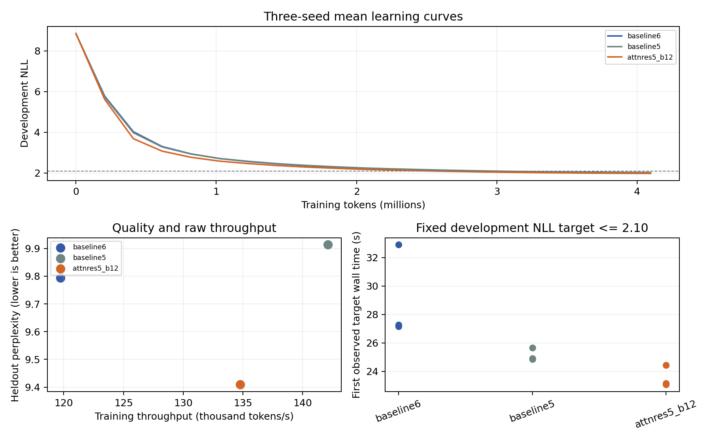

# mini-k3: compact language-model experiments

Fazal Hameed · Measured on a free Google Colab Tesla T4 · 18 October 2026

An adaptation of Block Attention Residuals from Kimi K3 to a small dense MiniMind
model. The study includes a development screen, locked three-seed confirmation,
an additional-domain check and repeated timing measurements.

| Confirmation mean | Six-layer baseline | Selected five-layer AttnRes |
|---|---:|---:|
| Parameters | 13,227,648 | 11,441,152 |
| Held-out TinyStories perplexity | 9.794 | 9.409 |
| Steady training tokens/second | 119,735 | 134,756 |

Mean paired changes: **3.93% lower held-out perplexity**, **12.56% higher training
throughput**, and **18.61% less time to development NLL <= 2.10**. The selected
model has **13.51% fewer parameters**. Five repeated timing trials showed a
10.98% mean paired throughput gain.

The ordinary five-layer control is faster than AttnRes but has worse held-out
quality. WikiText results improve in two confirmation seeds and regress in one.
These are narrow small-model results, not a full K3 reproduction, proof of
general LLM superiority, or a measurement of decoding/inference speed.

## Read the work

- [Technical report (PDF)](Mini_K3_Phase3_Technical_Report_Fazal_Hameed.pdf)
- [Full methods, results and limitations](PHASE3_REPORT.md)
- [Training and evaluation notebook](mini_k3_phase3.ipynb)
- [Recorded results](phase3_results.json) and [individual confirmation scores](confirmation_results.csv)
- [Training protocol](PROTOCOL.md), [additional-domain protocol](OOD_PROTOCOL.md), [timing protocol](TIMING_PROTOCOL.md)

## Complete runnable source and evidence

The complete folder structure is preserved in
[`mini_k3_phase3_2026-10-18.zip`](mini_k3_phase3_2026-10-18.zip), including Python
source, all three experimental stages, pinned upstream source and license,
individual run histories/timings, configurations, correctness checks and report.
The files beside the archive are convenient previews of the final study.

Download and extract the archive, then open
`mini-k3/phase3/mini_k3_phase3.ipynb` in a fresh Colab T4 runtime. The notebook
embeds the experiment source and fetches the pinned upstream model/tokenizer
and dataset. Read the protocols and notebook permission prompts before running.
The full workflow trains six development models and nine confirmation models.

Model weights and training-token caches are not included in the source archive.
Completed model exports were preserved in a private verified backup. Those
exports omit optimizer/scaler state and cannot resume the exact optimizer
trajectory after runtime loss. Retraining does not require access to that backup.

## References and provenance

- [MiniMind](https://github.com/jingyaogong/minimind), pinned commit
  `f659b55761b754d306bd140573493a6543cafd7f`; upstream Apache-2.0 license
  is preserved in the archive and [here](MINIMIND_UPSTREAM_LICENSE).
- [Kimi K3](https://arxiv.org/abs/2607.24653), Attention Residuals/depth mixing.
- [TinyStories](https://huggingface.co/datasets/roneneldan/TinyStories),
  pinned revision and CDLA-Sharing-1.0 attribution are recorded in the report.
- [WikiText](https://huggingface.co/datasets/Salesforce/wikitext); the additional
  evaluation uses a custom prefix/packing protocol, not standard published WikiText perplexity.

`SHA256SUMS` records the uploaded artifact hashes. The ZIP is the authoritative
complete project; preview files retain the measured contents.
